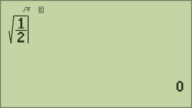

# LCD Math v0.0.1 for Graph Math+

A scientific calculator add-in with an LCD display refined against Chris's physical fx-85GT CW photograph. This release adds editable natural fractions and powers, placeholder boxes, correctly sized brackets and radicals, indexed roots, inverse-function superscripts, and clearer mathematical symbols. The main calculation screen contains the expression, answer, and calculator status indicators only. It has no shortcut bar, branding, tooltips, or help text.

[Download the latest release](https://github.com/cis5123467-sudo/lcd-math-casio/releases/latest) · [Complete controls](KEYBINDS.md) · [Release notes](release/RELEASE-v0.0.1.md)



## Install

Copy `release/lcd-math-v0.0.1.g3a` to the root of the calculator's USB storage, eject it, then launch **LCD Math** from **TOOLS** on the existing MPM installation. No companion assets are required. Target: Chris's working Graph Math+, OS **02.00.2202**, with MPM already installed.

## LCD contrast

Press **SETTINGS** or **TOOLS**, select **Contrast**, and press **OK/EXE**. Use **left/right** to adjust the eleven levels from 0 to 10. The text, LCD background and four shade samples update immediately, alongside a textbook formula preview. Press **OK/EXE** or **BACK** to return. Contrast is saved with the other settings when leaving the add-in with **HOME**. This changes the LCD appearance inside the add-in.

## Calculate

- Number and arithmetic keys work normally. **OK/EXE** evaluates. Missing final closing parentheses are completed when evaluating.
- **Left/right** moves the insertion cursor. **SHIFT + left/right** jumps to the start/end. Long expressions scroll horizontally.
- **DEL** deletes the previous character. **BACK**, **AC**, or **SHIFT + DEL** clears the current expression.
- **Up/down** moves between numerator/denominator fields while editing a fraction; otherwise it recalls and edits the last 20 expressions. In an exponent, DOWN exits the exponent; UP from immediately after a power re-enters it.
- **FORMAT** toggles exact/decimal answers. Supported exact forms include reduced fractions, single surds and rational multiples of pi; other results use decimal output.
- After an answer, entering an operator continues with **Ans**. Entering a number starts a fresh expression. The answer key inserts `Ans`.
- **CATALOG** lists functions. **SETTINGS/TOOLS** changes angle units, output format, precision and contrast, and opens memory and help.
- **HOME** saves history, settings and memories, then exits to the launcher.

Fractions use a template: press the fraction key, type the numerator, press DOWN (or RIGHT at the end of the numerator), then type the denominator. Press RIGHT at the end of the denominator to leave the fraction. UP returns to the numerator. Pressing the fraction key after an existing value captures that value as the numerator. Nested fractions are supported. Empty fields display hollow boxes. The ordinary division key displays a division sign (÷).

The power key inserts a raised exponent box. Type the exponent, then press RIGHT or DOWN to leave it. Fractional and nested powers are supported. Grouping and function keys create their closing brackets automatically; pressing the closing-bracket key steps over an existing closing bracket. Empty root and function arguments have placeholders too. Tall expressions keep natural structure and scroll to the active field.

## Scientific functions

Arithmetic, parentheses, implicit multiplication such as `2(3+4)`, powers, square/cube/nth roots, reciprocal, absolute value, percentages and factorials; trigonometric and inverse trigonometric functions in degrees, radians and gradians; natural, common and arbitrary-base logarithms; exponentials; hyperbolic and inverse hyperbolic functions; combinations, permutations, greatest common divisor, least common multiple, remainder, min/max and rounding. The catalog also includes the standard normal CDF and binomial probability mass function.

Binary function arguments use a comma, for example `logb(8,2)`, `root(-32,5)`, `ncr(10,3)` or `binom(5,2,0.5)`. The maximum expression length is 111 characters. Calculations use double precision internally; normal decimal display uses 10 significant digits. FIX and SCI expose 0–9 decimal places. Invalid real domains and non-finite results produce an error.

This is a real-valued scientific calculation app. It does not reproduce the fx-991CW's separate matrix, vector, complex, spreadsheet, equation, distribution-editor or statistics-editor applications, or the Graph Math+'s graphing applications.

## Keys and memory

| Key | Action |
| --- | --- |
| SHIFT + SIN/COS/TAN | Inverse trig |
| SHIFT + square | Square root |
| SHIFT + square-root key | Cube root |
| SHIFT + LN | Exponential |
| SHIFT + LOG | Power of 10 |
| SHIFT + dot | Factorial |
| SHIFT + division/fraction | Percent |
| SHIFT + EXP or SHIFT + 7 | Pi |
| SHIFT + negative or SHIFT + 8 | Euler's number |
| SHIFT + right parenthesis | Comma |
| SHIFT + FORMAT | Cycle DEG/RAD/GRAD |
| VARS or SHIFT + answer/store | Memory menu |
| ALPHA + 1 through 9 | Recall A, B, C, D, E, F, X, Y, Z |

In the memory menu, **SHIFT + OK/EXE** stores the last numerical answer in the selected variable. **OK/EXE** inserts that variable into the expression. The variable must have a stored value before use. Memory recall preserves numerical double precision; exact symbolic information is maintained by Ans for supported exact results.

For fx-CG50 emulator checks, F1 opens Catalog, F2 opens Settings, F3 opens Memory, and F4 opens Help. The Math+ uses its named keys.

## Saved files

The add-in creates `lcdmath.dat` in USB storage on normal HOME exit, retaining a previous valid copy as `lcdmath.bak`. `lcdmath.tmp` is used while replacing the save. A version and checksum reject damaged saves; a valid backup can restore the previous session. No save files need to be installed initially. An expression that has not yet been evaluated is not saved.

## Build

Clone the repository and build from its folder:

```sh
git clone https://github.com/cis5123467-sudo/lcd-math-casio.git
cd lcd-math-casio
python3 tools/build.py
```

The existing fxSDK/gint toolchain is required. Set `CASIO_SDK` to the fxSDK installation prefix if needed; `CMAKE` can select the CMake executable. This project uses fxSDK's colour CMake toolchain, the `Gint::Gint` target, and `GenerateG3A`. The small local `FindGint.cmake` resolves this installation's libraries through `fxsdk path` because its sysroot is outside GCC's default library path. Icons and font data are already generated; `tools/assets.py` regenerates them with Pillow.

Known build: SH GCC **15.2.0**, fxSDK dev **a6e46eb6**, gint dev **463f180f** (reported version 2.11.0), fxlibc dev **b96335c2**, OpenLibm **9828d2e3**. These are the Math+-aware toolchain revisions used by the existing local NumPlay and NumAI ports. The calculation engine and textbook layout started from Chris's local NumAI-MPM project. The display, editor integration, catalog, controls, contrast and save format are specific to this add-in. The fxlibc printf adaptation and linked libraries' notices are under `vendor/`.

## Verification

Run `python3 tools/test.py` for isolated host checks, `python3 tools/check_mpm.py /path/to/mpm release/lcd-math-v0.0.1.g3a` for loader metadata, and `python3 tools/smoke.py` with Pillow and the local emulator for runtime checks.

The following checks passed for the released binary:

- 29 dedicated SuperH fraction, radical, bracket, power, inverse-function and symbol scenarios. Screenshots and decoded saved values are in `verification/render-v0.0.1/`.
- 27 host layout cases check drawn bounds, superscript carets, numerator/denominator carets, symbolic function rendering and implicit-product grouping under AddressSanitizer and UndefinedBehaviorSanitizer.

- 66 numerical/domain cases plus template editing and grouping cases under host AddressSanitizer and UndefinedBehaviorSanitizer, plus exact forms, editing, memory, history, display formats, saves and corrupt-save recovery.
- Actual SuperH binary execution in **emuCasioCalc's fx-CG50 model**: arithmetic, fractions and decimals, automatic parentheses, radicals, trig, factorials, Ans continuation, insertion and deletion, history editing, error correction, catalog, combinations, DEG/RAD/GRAD, memory, help, horizontal scrolling and clean HOME exit.
- Live contrast changes at both limits, persisted contrast across independent launches, identical restored calculation screens, and no footer text on the main LCD. Screenshots and logs are in `verification/smoke-v0.0.1/`.
- MPM v1.1's actual discovery and metadata C functions, with a host file shim, recognise the G3A name, version and icon blocks. The G3A header sizes and checksums are also valid.

The emulator does not model Graph Math+ hardware. Physical startup, named-key operation, contrast readability, saving, exit and relaunch on Chris's Graph Math+ remain to be checked on that device. Display revision and exact installed MPM build are not established.

## Complete key guide and future filenames

See [KEYBINDS.md](KEYBINDS.md) for all implemented controls and worked examples. The current release is `lcd-math-v0.0.1.g3a`; the next is `lcd-math-v0.0.2.g3a`, incrementing the patch number each time. Existing 1.0.x binaries retain their original names. The release rule is recorded in `AGENTS.md`.
